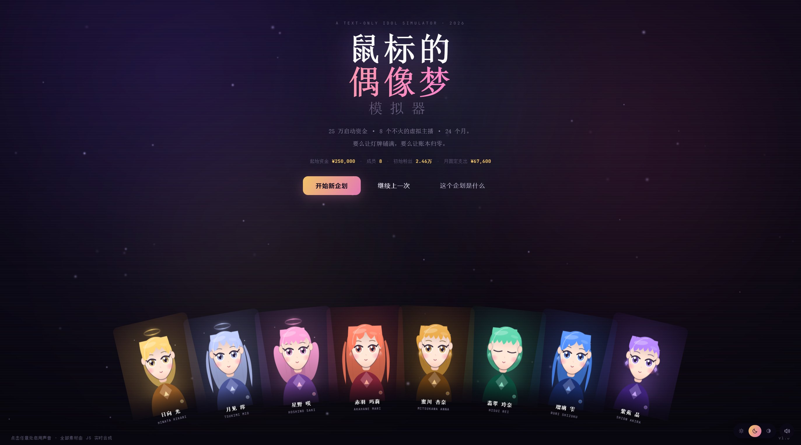
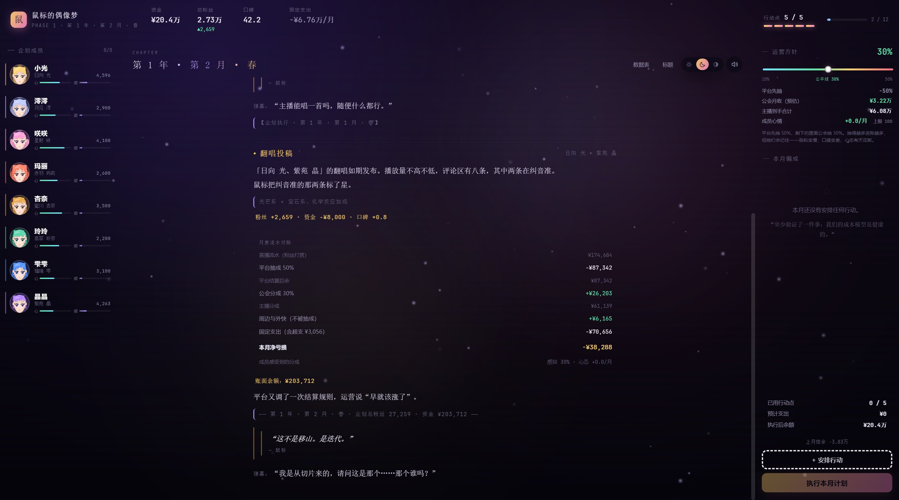
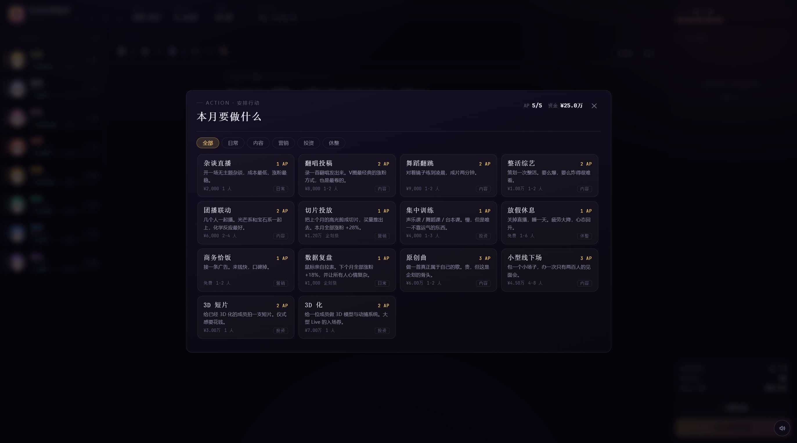
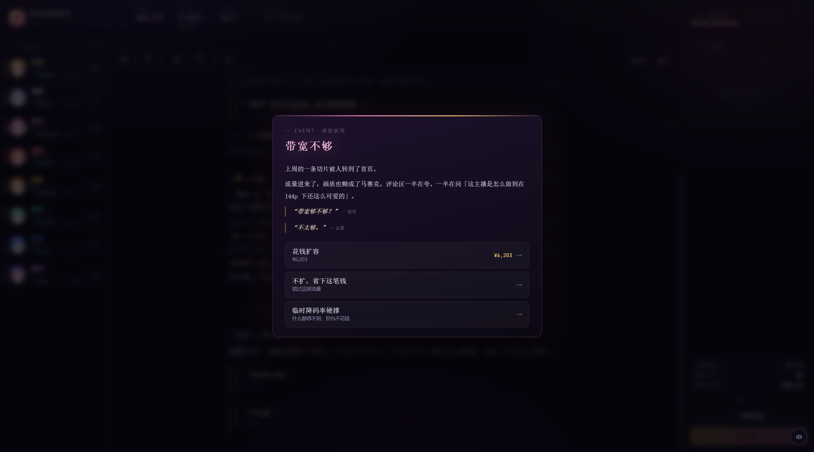
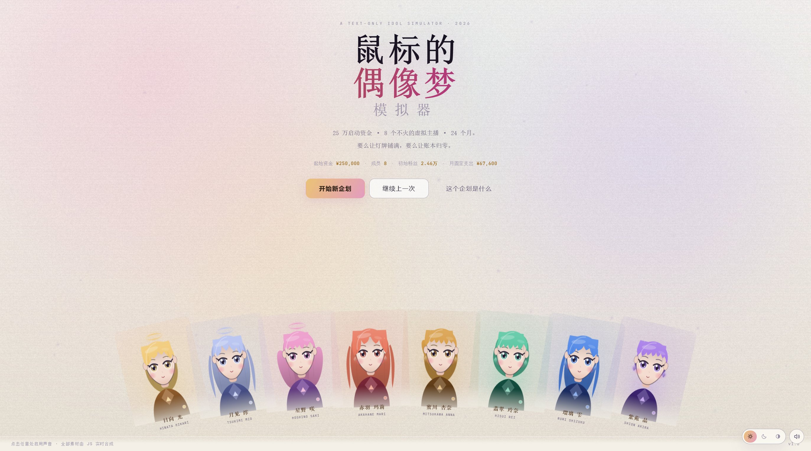
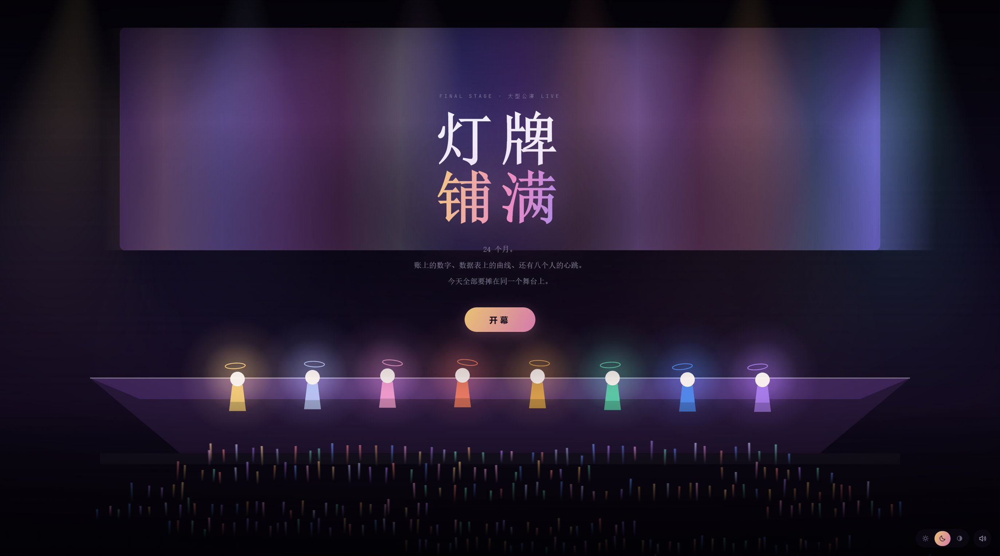

# 鼠标的偶像梦模拟器

> 一个没有素材的游戏——所有画面与声音由 JS 实时合成。

文字演出类的虚拟偶像养成推演游戏。你是企划的新负责人，手里有 **25 万资金**、
**8 个不火的虚拟主播**，和 **24 个月**。

要么让灯牌铺满，要么让账本归零。

---

## 跑起来

```bash
npm install
npm run dev        # http://localhost:5288
npm run build      # 产物在 dist/
npm run typecheck
npm run sim        # 无界面平衡模拟器
```

纯前端，不需要后端。存档在 `localStorage`。

---

## 玩法

### 回合
一个月一回合，每回合 **5 点行动点（AP）**。安排好本月的行动后点「执行本月计划」，
企划会一次性结算，然后进入月末：算收入、扣固定支出、结算心态与疲劳、触发随机事件。

### 两个阶段
| 阶段 | 长度 | 目标 |
| --- | --- | --- |
| 第一阶段 | 12 个月 | 活下来：不破产，也没有人毕业 |
| 第二阶段 | 12 个月 | 攒够资本，把八个人送上线上演唱会 |

### 钱花在哪
日常开播不花钱。杂谈、翻唱、舞蹈、整活、团播吃的是 **AP、疲劳和心态**——
现实里的 MCN 也不会为「她今天开播」付钱。资金只花在这几件事上：

| 花在 | 行动 / 支出 | 价格 |
| --- | --- | --- |
| 推流买量 | 切片投放 | ¥10,000 |
| 培训 | 集中训练（请老师上门） | ¥6,000 |
| 原创 IP | 原创曲 | ¥20,000 |
| 周边制作 | 周边企划（打样、开模、仓储） | ¥12,000 / 批，最多 3 批 |
| 线下 | 小型线下场 | ¥16,000 |
| 3D | 3D 化 / 3D 短片 | ¥22,000 / 人、¥9,000 |
| 养人 | 固定支出（底薪 + 运营 + 规模成本） | 每月自动扣 |
| Live | 制作费（虚拟舞台 / 导播 / 推流带宽） | ¥250,000 |

所以每个月的选择变成：**这钱是留着养人，还是拿去买速度（推流）、买资产（原创、周边、3D）、
买能力（培训）？** 不花钱只是长得慢，不会立刻死；花钱花错了才会死。

### 钱从哪来
直播流水按这个顺序分：

```
粉丝打赏（流水）× 打赏边际
  └ 平台先抽 50%
      └ 剩下的里面，公会抽 guildCut（默认 30%，可调 10%–50%）
          └ 其余给主播
周边与外快：不被抽成；开一批周边就涨一档单价与库存上限（最多 3 批）
商务恰饭：一次性外快，直接进账
```

「打赏边际」是条双曲线：核心粉一直打赏，路人粉不会。粉丝涨到几十万之后，
每个新粉丝的贡献会被稀释——不然后期收入会跟着粉丝一起指数涨，账上堆出一笔没处花的钱。

**公会抽成是游戏里最重的那根杠杆。** 抽高了进账多，但代价是三重：

1. **涨粉变慢** —— 被压榨的人不会为你拼命（最高 -28% 内容产出）。
2. **口碑变差** —— 粉丝会替主播鸣不平，而口碑直接影响收入倍率。
3. **心态有天花板** —— 抽到 50% 时，放再多假她们也开心不起来（上限 20）。

而且**成员记住的是长期分成**：感知值以每月 40% 的速度追随实际值，
临时调低一两个月救不了场；每次改动超过 5 个点还会额外掉一次心态（「又改分成？」）。

实测结果（`npm run sim`，接近最优的机器玩家）：

| 公会抽成 | 活到第 24 月 | 平均粉丝 | 平均结余 | Live 评级 |
| --- | --- | --- | --- | --- |
| 10–20% | 99.5% | 54 万 | 70 万 | 满月 |
| 30%（公平线） | 100% | 49 万 | 246 万 | 满月 |
| 40% | 100% | 40 万 | 214 万 | 半场灯 |
| 50% | 96.5% | 17 万 | 44 万 | 只亮了一排 |
| 会看情况调 | 100% | 49 万 | 246 万 | 满月 |

抽成现在换的不是生死，而是**钱和梦的配比**：抽低，公会账上紧（制作费要攒几个月），
但粉丝最多、结局最好看；抽高，进账快，可粉丝上不去，最后只能亮半场灯。
也就是说：**你可以靠压榨活下来，但那个梦会变得很小。**

### 三个会杀掉你的东西
1. **资金**：每月固定支出 =（8 人底薪 + 运营）+ 规模成本。规模成本跟着粉丝涨
   （棚、带宽、法务、税），所以「涨粉」本身也会变贵。日常行动不花钱，破产只来自
   **固定支出扛不住**，或者**投资下得太狠**。
2. **疲劳**：不安排休息，疲劳会一直堆。疲劳高的人心态掉得飞快。
3. **心态**：心态归零的人会进入毕业倒计时。**任何一个人毕业，企划立刻结束。**

### 数字为什么不是写死的
每次行动的实际涨粉 = 期望值 × 发挥。发挥分成三层：

1. 大多数时候贴着期望值走（对数正态，杂谈很稳、整活很飘）；
2. 小概率**爆款**（1.6–3.2 倍）或**翻车**（砍到两三成），整活的上下限最大；
3. 落到哪一档，就播哪一档的文案——所以「爆了」一定配一个爆了的数字。

另外每个月还有一个**平台风向**：一个内容方向被推（×1.35）、一个被限流（×0.78），
开局就会出现在日志和行动面板上。它不是噪音，是这个月该往哪边使劲的提示。

### 线上演唱会的评分
`粉丝体量 + 成员能力 + 成员心态 + 企划口碑 + 3D 完成度 + 制作规格 - 疲劳扣分`

制作费要 ¥250,000，3D 化每人 ¥22,000（八个人全做 17.6 万，两年里是攒得出来的）。
付不起制作费，就只能用默认场景和一台推流机开播。

### 结局
- **BE**：破产 / 有人毕业。子结局：破产清算、毕业、空城计。
- **HE**：撑到线上演唱会并关播。按评分分四档：
  - 只亮了一排 / 半场灯 / 满月 / 灯牌铺满
  - 还有一个隐藏档：**让山自己动起来**（评分 ≥ 88）
- HE 之后可以进入 **无限流**：没有剧情，只有数据。想跑多久跑多久。

---

## 八个人

| 光芒系 | 宝石系 |
| --- | --- |
| 晴昼Hikari（日光） | 朱砂Mari（水红玛瑙） |
| 月白Mio（月光） | 琥珀Anna（蜜蜡石） |
| 星野Saki（星光） | 碧玉Rei（翡翠） |
|  | 砚青Shizuku（青金石） |
|  | 紫曜Akira（紫水晶） |

---

## 技术

Vite + Vue 3 + TypeScript + Pinia + **PixiJS 8**。

**没有任何图片、音频、字体文件。** 全部由代码生成：

- `src/render/avatar.ts` —— 程序化绘制角色立绘（8 种发型、参数化的脸部与瞳孔、
  刘海投影 / 边缘光 / 发丝、光芒系的光环 / 宝石系的耳坠）。
- `src/render/pixi/` —— Pixi 渲染层，全应用共用一个 WebGL 上下文：
  - `ambient.ts` 常驻底噪：渐变底 + 缓慢漂移的色斑 + 尘埃，跟随主题换色。
  - `stage.ts` 线上演唱会现场（虚拟舞台）：聚光灯锥、屏幕色带、8 个人、灯牌人浪、粒子，全部 GPU 合成。
  - `textures.ts` 用 canvas 现画贴图（柔光圆点、荧光棒、光锥、星屑、颗粒），再交给 Pixi。
  - `backdrop.ts` 单例，管理初始化、尺寸、主题与场景切换；WebGL 不可用时自动退回 CSS 背景。
- `src/audio/engine.ts` —— Web Audio 合成器。7 首程序化 BGM：8 小节和弦进行（带七度 / 九度）、
  有重音与摇摆的琶音、主旋律、带加花和留白的鼓组，以及混响 / 附点延迟 / 侧链 / 总线压缩；
  全部 UI 音效（含合成掌声）也在这里。
- `src/render/color.ts` —— 颜色工具与确定性伪随机。

### 主题

浅色 / 深色两套，可手动切换，也可以跟随系统：

- 所有颜色都是 CSS 变量，定义在 `src/styles/base.css` 的
  `html[data-theme='dark']` 和 `html[data-theme='light']` 两块里。
- 选择存放在 `localStorage`，`index.html` 里有一段内联脚本在首屏前就把主题定下来，避免闪白。
- 跟随系统时监听 `prefers-color-scheme`，实时切换；Pixi 的色斑与粒子也会跟着换色。
- 右下角（主界面里是标题栏右侧）三个图标分别是 浅色 / 深色 / 跟随系统。

深色是霓虹感的「演出后台」，浅色是偏纸张的「企划书」；Live 直播间在两种主题下都保持暗场——
演出本来就是黑的。

### 目录
```
src/
  data/        成员、行动、事件、结局、文字演出库
  engine/      类型、随机数、平衡参数、结算逻辑
  stores/      Pinia 游戏状态机
  render/      程序化绘图
  audio/       程序化音频
  components/  UI 组件
  views/       标题 / 主界面 / Live / 结局
scripts/sim.ts 无界面平衡模拟器
```

### 数值都在 JSON 里
改数字不用碰代码：

| 文件 | 内容 |
| --- | --- |
| [`src/data/config.json`](src/data/config.json) | 经济、收入与抽成、打赏边际、随机（luck / trend）、行动点、疲劳、心态、毕业、Live 评分与档位、事件概率 |
| [`src/data/idols.json`](src/data/idols.json) | 八个人的初始能力、粉丝、心态、配色、造型编号 |
| [`src/data/actions.json`](src/data/actions.json) | 每个行动的 AP / 花费 / 基础涨粉 / 疲劳 / 心态 / 属性成长 / 口碑 / 随机分布 |

`src/engine/balance.ts` 只负责读配置和派生（固定支出与规模成本、涨粉规模、打赏边际、收入拆解、
抽成对心态/涨粉/口碑的影响）；`engine/luck.ts` 是发挥的随机模型，`engine/trend.ts` 是每月的平台风向。
两个 JSON 都支持 `_comment` 字段，写注释不会影响解析。

### 平衡
`npm run sim [局数] [naive]` 会跑无界面模拟，输出存活率、结局分布、粉丝区间，
外加一张**随机性体检表**（同一行动掷 3000 次的 P5/P25/中位/P75/P95 与爆款、翻车率）。
环境变量可以定点测某个策略：`GUILD_CUT=0.4 npm run sim 150`。

调试用的网址参数：

| 参数 | 作用 |
| --- | --- |
| `?phaseMonths=1` | 把每个阶段压缩成 1 个月，方便走完整个结局流程（正式游戏恒为 12） |
| `?preview=stage&fans=240000&threed=8` | 直接预览 Live 舞台，不用真的打到第 24 个月（这个场景不会写存档） |

---

## 关于梗

鼠标是一个开公会的老板，一直想搞一个「全员线上演唱会」的偶像企划，屡战屡败，
于是在圈内变成了一个梗。这个模拟器就是为了模拟这件事。

相关文章：<https://www.jiahai.top/2026/10/03/111.html>

---

## 截图

| | |
|---|---|
|  |  |
|  |  |
|  |  |
